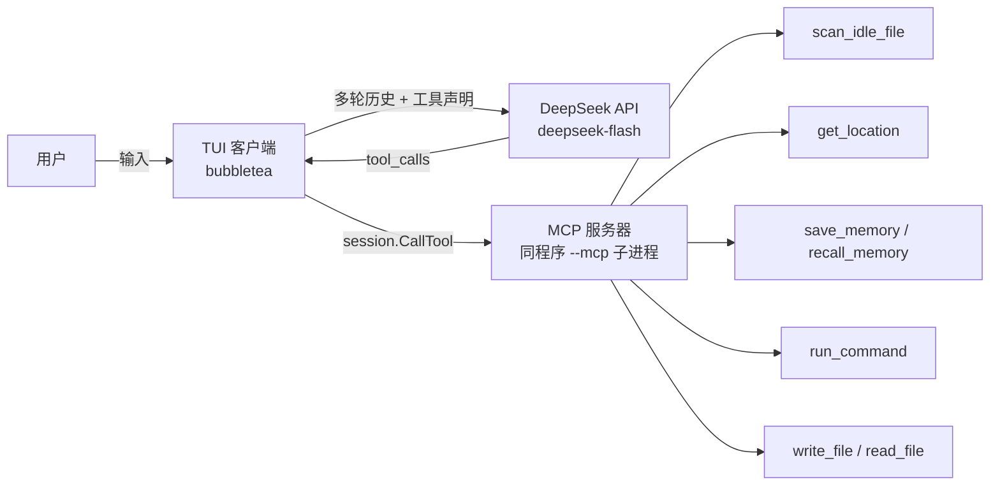
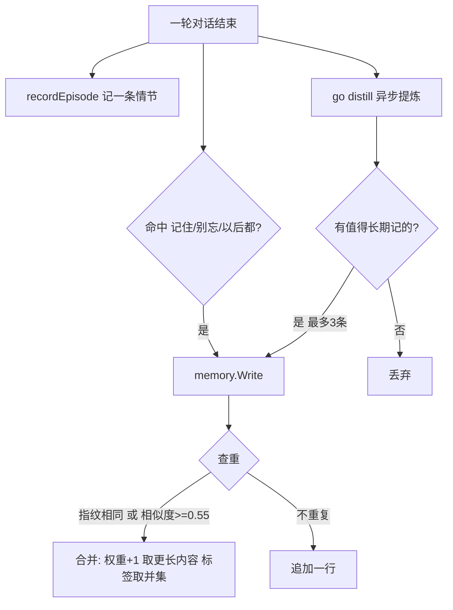

# wuhu

一个用 Go 手写的小型 Agent：**终端 TUI 聊天界面 + 自带 MCP 工具服务器 + 长期记忆 + 上下文压缩**。

没有套任何 Agent 框架 —— 对话循环、工具注册、记忆读写、上下文预算，全部自己写。整个程序只有一条 `main`，按参数决定自己是 "聊天客户端" 还是 "工具服务器"。

> 起点只是 "遍历文件夹，找出闲置文件"，后来一点点长成：能调本机命令、能读写文件、能记住你上次说过什么、聊久了也不会把上下文撑爆。

## 功能一览


| 能力        | 说明                                                             |
| --------- | -------------------------------------------------------------- |
| 终端聊天界面    | bubbletea + lipgloss，全屏 TUI、流式状态提示、鼠标滚轮翻历史                     |
| 自造 MCP 工具 | 官方 `modelcontextprotocol/go-sdk`，工具以 stdio JSON-RPC 提供，客户端动态拉取 |
| 闲置文件扫描    | 按 atime（最后访问时间）判定闲置，遍历目录，导出 Markdown 报表                        |
| 本机命令执行    | `cmd /c` 执行一条命令，回传输出与退出码，旁路落日志                                 |
| 文件读写      | 纯文本读写，写入自动建父目录，不经过 shell，特殊字符安全                                |
| 长期记忆      | 本地 JSONL 存储，判重合并、三槽注入、遗忘曲线淘汰                                   |
| 情节记忆      | 记录 "上次到底聊了什么"，新会话开场自动接上上下文                                     |
| 上下文压缩     | 预算 60k token，到 80% 才压一次，压不动就硬裁，绝不 400                          |
| 定位查询      | 基于公网 IP 的城市级位置，无系统权限依赖                                         |
| 配置容错      | 配置缺节点、JSON 写坏都不致命，一律回落代码内默认值                                   |

## 整体架构

单个可执行文件，两种身份：




启动流程：


1. `main` 检查 `os.Args[1] == "--mcp"`，是就把自己当 MCP 服务器跑起来（stdio 传输）；

2. 否则作为 TUI 客户端启动，通过 `mcp.CommandTransport` 再拉起一份 `自己 --mcp` 子进程；

3. 建立 `ClientSession`，TUI 每轮把整段历史交给模型，模型要调工具就由这个会话执行。

工具列表每轮会话只拉一次，然后转成 OpenAI 的 `function` 声明交给模型；模型返回 `tool_calls` 时按名字逐个 `session.CallTool`，结果回填成 `tool` 消息继续循环。死循环有闸：**单轮最多 40 次工具调用**，超了强制让模型收尾作答。

## 内置工具（MCP）


| 工具名              | 主要参数                                   | 作用                                                          |
| ---------------- | -------------------------------------- | ----------------------------------------------------------- |
| `scan_idle_file` | `targetPath` `idleDays` `exportMdPath` | 扫描目录里超过阈值天数未访问的文件，导出 Markdown 报表；回给模型的只是数量摘要，不塞几千行路径        |
| `get_location`   | 无                                      | 调 [ip-api.com](https://ip-api.com)，返回城市级位置、经纬度、时区、运营商、公网 IP |
| `save_memory`    | `content` `tags`                       | 写入长期记忆，重复内容自动并入旧条目                                          |
| `recall_memory`  | `keyword` `limit`                      | 按相关度检索记忆，最多 10 条                                            |
| `run_command`    | `command` `workdir` `timeout`          | 在本机执行 shell 命令，返回输出与退出码，超时默认 30 秒                           |
| `write_file`     | `path` `content` `append`              | 写文本文件，自动创建目录；默认覆盖，`append=true` 追加                          |
| `read_file`      | `path`                                 | 读取文本文件全文，目录 / 不存在会明确报错                                      |

工具注册用的是 SDK 的泛型写法：


```
mcp.AddTool(server, &mcp.Tool{
    Name:        "scan_idle_file",
    Description: "扫描本机指定目录，找出超过阈值天数没有访问的闲置文件……",
}, runScanIdleFile)
```

入参结构体带 `jsonschema` 标签，**schema 自动生成**，参数反序列化、校验、错误包装全交给 SDK。加新工具只需要在 `StartAutoServer` 里多挂一行 `registerXxx(server)`，不用维护注册表和映射。

错误语义也按 MCP 规范走：业务失败返回 `IsError=true` 的结果，让模型能看见 "失败了、失败在哪"，而不是当成正常输出继续编。

## 长期记忆

事实记忆存在 `memory/memory.jsonl`，一行一条，append-only；情节记忆单独放 `memory/episodes.jsonl`—— 两者生命周期不同，混在一起会被淘汰逻辑误删。

一条记忆长这样：


```
{"id": 3, "time": "2026-11-17 10:20", "updated": "2026-11-17 10:20", "kind": "preference",
 "content": "用户偏好回复用中文", "tags": "偏好,语言", "source": "distill",
 "weight": 3, "status": "active", "verified": "2026-11-17", "finger": "用户偏好回复用中文"}
```

字段里 `kind` 分 `fact / preference / task / project / rule / env`，`status` 分 `active / done / dropped`，`weight` 是 1\~5 的优先级。

### 记忆是怎么进去的





* **旁路提炼**：每轮回答完，`go distill(...)` 在后台让模型只从 "本轮" 里挑值得长期保留的事实、偏好、决定，最多 3 条。异步、20 秒超时、失败静默 —— 记忆挂了不影响聊天。

* **规则兜底**：`autoRemember` 命中 "记住、记一下、别忘了、以后都……" 这类关键词就直接落一条，防模型偷懒不调 `save_memory`。

* **判重合并**：`memory.Write` 是唯一写入口。靠指纹（归一化后只剩实义字）精确命中，配合覆盖度 + Dice 的综合分 `0.6*Coverage + 0.4*Dice`，相似度 ≥ 0.55 就合并；归一化后不足 6 个字的短句退回纯 Dice，宁可不错并。合并时权重 +1（封顶 5）、内容取信息更全的那句、标签取并集。

### 记忆是怎么被用上的

每轮组装 system prompt 时**重新读一次记忆文件**，所以刚写进去的下一轮就能用。注入分三槽，总预算 600 字符：


| 槽位     | 内容                    | 条数上限 |
| ------ | --------------------- | ---- |
| 用户画像   | preference 优先，其次 fact | 3    |
| 未完成的待办 | `kind=task` 且 active  | 4    |
| 相关经验   | 与当前这句话相关度 ≥ 0.10 的记忆  | 5    |

相关槽的打分是 `0.5*相关度 + 0.3*新鲜度 + 0.2*权重`；新鲜度按 30 天半衰期算，就是最小号的遗忘曲线。`recall_memory` 用的是同一套 `Rank`，保证 "工具查到的" 和 "提前塞进 prompt 的" 标准一致。

画像槽只放 3 条是刻意的：它每轮都在场，塞满 8 条的结果是任何一条偏好都会黏在每次对话里，把真正该说的那句稀释掉。

### 记忆维护


* 启动时、以及每 10 轮对话后，`go memory.Maintain(...)` 后台跑一次；

* 先 `Compact`：丢掉 `dropped` → 两两合并重复（同 kind 或指纹相同）→ 超过 200 条按 "权重为主 + 30 天内验证过加分" 淘汰，**preference 类型保命**；

* 再 `PruneEpisodes`：情节库只留最近 300 条；

* 整份重写走 " 先写 `.tmp` 再 `rename`"，中途崩了原文件仍完整；进程内用 `sync.Mutex` 串行化写入。

### 情节记忆

情节只记 "发生了什么"，不记结论，每条截断 200 字。新会话第一句才注入最近 6 条，相邻两条间隔超过 **30 分钟**就插一行 `─── 新会话 ───` 分隔 —— 否则模型会把昨天的话题当成眼下的上下文。

## 上下文管理

模型是 `deepseek-flash`（理论上限 1M token），但**不贴着上限用**，成本是按 token 线性涨的：


| 参数   | 值         | 含义                    |
| ---- | --------- | --------------------- |
| 预算   | 60k token | 上限的 6%                |
| 触发线  | 预算 80%    | 留余量给压缩请求本身，真满了再压会 400 |
| 保留段  | 预算 40%    | 最近这段原样保留              |
| 压缩目标 | 预算 30%    | 压完还必须这么小，否则判定失败       |

流程：平时什么都不做 → 到 80% 调一次模型把老对话压成摘要（保留事实、决定、工具结论，删寒暄和失败重试）→ 压完仍超 30% 就**降级硬裁**，直接丢最老的。

两个细节：切点必须对齐到 `user` 消息，从中间硬切会切出 "孤儿 tool 结果" 导致 400；token 数不做真分词，中文按字、英文按 4 字符粗估，够判阈值就行。

`system` 消息每轮都是新建的，不会留在历史里越滚越长；旧摘要按原样挂在历史头部，下一轮继续接上。

## 快速开始


```
git clone https://github.com/gaoz30500-beep/wuhu.git
cd wuhu
go mod tidy
go run .
```

打包成单文件：


```
go build -o wuhu.exe .
./wuhu.exe        # TUI 客户端
./wuhu.exe --mcp  # 作为 MCP 服务器（正常情况下由客户端自动拉起，不用手动跑）
```

启动后直接说话，例如：


* `扫描 E 盘的闲置文件`

* `看看 E 盘下哪些文件超过 30 天没打开过`

* `记一下：我习惯用 VS Code 写代码`

* `我以前说过我电脑是什么配置？`

* `帮我看看当前目录下有什么`

界面键位：回车发送，`PgUp/PgDn` `↑/↓` `Ctrl+U/Ctrl+D` 翻历史，鼠标滚轮也能滚，`Ctrl+C` 或 `Esc` 退出。

### API Key

程序里用的是 DeepSeek 的 OpenAI 兼容接口（`https://api.deepseek.com`）。运行前把 Key 填进去，建议改成读环境变量，**不要把 Key 硬编码进代码再推到公开仓库**—— 一旦进了 git 历史，删文件也没用，只能去后台吊销重发。

## 配置

配置文件默认找 `MCP/mcp_config.json`，查找顺序：环境变量 `AGENT_MCP_CONFIG` → 当前工作目录下 `MCP/mcp_config.json` → 可执行文件同目录的 `mcp_config.json`。


```
{
  "tools": {
    "scan_idle_file": {
      "targetPath": "E:",
      "idleDays": 30,
      "exportMdPath": "./out/result.md"
    },
    "get_location": {
      "apiUrl": "http://ip-api.com/json/?lang=zh-CN",
      "timeout": 8
    },
    "save_memory": { "storePath": "memory/memory.jsonl" },
    "recall_memory": { "storePath": "memory/memory.jsonl" },
    "run_command": {
      "workdir": ".",
      "timeout": 30,
      "logPath": "./out/command.log"
    }
  }
}
```

原则是**任何节点、任何字段都可以缺省**：缺了就回落代码里的默认值。以前缺一个 `tools` 节点整个 server 都起不来，等于一个工具的配置写错就拖垮全部工具 —— 现在 JSON 写坏也只是打一条 stderr 日志，照常用默认值跑。

其他环境变量：


| 变量                   | 作用        |
| -------------------- | --------- |
| `AGENT_MCP_CONFIG`   | 指定配置文件路径  |
| `AGENT_MEMORY_PATH`  | 覆盖事实记忆库路径 |
| `AGENT_EPISODE_PATH` | 覆盖情节记忆库路径 |

> MCP 服务器跑在 stdio 上，
>
> **stdout 是 JSON-RPC 通道**
>
> ，所有日志只能写 stderr。往 stdout 打一行字，协议流就乱了。

## 目录结构


```
.
├── main.go              # 入口 + TUI 界面（bubbletea 模型、渲染、键位）
├── LLM/
│   ├── ChatLoop.go       # 对话循环：拉工具、执行 tool_calls、40 轮上限收尾
│   ├── ContextWindow.go  # token 估算、懒压缩、硬裁
│   ├── MemoryDistill.go  # 旁路提炼（异步 distill）
│   ├── SystemPrompt.go   # system prompt 组装、三槽注入、规则兜底、情节记录
│   └── MCPToolBridge.go  # MCP 工具声明 → OpenAI function 声明
├── MCP/
│   ├── MCPServer.go      # server 组装，挂载全部工具
│   ├── RunMCPServer.go   # --mcp 分支入口
│   ├── config.go         # 配置加载与查找顺序
│   ├── ToolScan.go       # scan_idle_file
│   ├── ToolLocation.go   # get_location
│   ├── ToolMemory.go     # save_memory / recall_memory
│   ├── ToolCommand.go    # run_command（含命令日志）
│   ├── ToolWrite_File.go # write_file / read_file
│   ├── mcp_config.json   # 工具默认值
│   └── learn/            # MCP 分步学习示例（协议、角色、stdio 等）
├── memory/
│   ├── store.go          # Record 定义、LoadAll、Search、Render
│   ├── write.go          # 唯一写入口：查重 → 合并 / 追加
│   ├── finger.go         # 归一化、指纹、Dice、覆盖度、判重综合分
│   ├── rank.go           # 打分、三槽渲染、预算内截断
│   ├── maintain.go       # Compact / Maintain：去重合并 + 淘汰
│   └── episode.go        # 情节记忆的写入、渲染、裁剪
├── scanner/
│   ├── Scanner.go        # WalkDir 遍历，按 atime 筛闲置文件
│   ├── Resolver.go       # IdleResolver 策略接口（可换 mtime 等实现）
│   ├── ValidateDirPath.go# 路径校验（不存在 vs 没有闲置文件要分开报）
│   └── Resource.go       # 扫描结果结构
└── OutPut/
    ├── Output_Define.go  # Markdown 报表模板导出
    └── Dto.go            # ReportItem
```

## 技术栈


| 用途   | 依赖                                                       |
| ---- | -------------------------------------------------------- |
| 模型接入 | `github.com/sashabaranov/go-openai`（指向 DeepSeek 兼容接口）    |
| 工具协议 | `github.com/modelcontextprotocol/go-sdk`（stdio JSON-RPC） |
| TUI  | `charmbracelet/bubbletea` + `bubbles` + `lipgloss`       |
| 语言   | Go 1.26                                                  |

不引入 tokenizer、向量库、数据库、ORM：记忆是纯文本 JSONL，检索是二元组 + Dice，上下文判阈值靠粗估。够用，而且打开文件就能看懂里面是什么。

## 设计取舍


* **自己造 MCP server 而不是接第三方的**：单文件、零外部依赖、随 exe 一起走；工具和 Agent 同仓，改工具不用对齐两套代码。

* **工具失败要能被模型看见**：一律走 `IsError=true`，模型读到错误原文才知道该改参数重试，而不是把错误当结论继续往下编。

* **判重不靠 "整句子串匹配"**：那套永远命不中，等于没查重。换成归一化指纹 + 覆盖度，才能认出 "换种说法"。

* **记忆宁缺毋滥**：注入分三槽、条数有上限、预算 600 字、相关度有门槛。宁可少放，也不堆一堆把 prompt 稀释掉。

* **一切维护都异步且静默**：压缩、提炼、维护、命令日志，失败都不许影响当前这轮回答。

## 已知限制


* `run_command` 的 "改动类命令先向用户确认" 目前是**提示词约束**，没有代码级的二次确认拦截；真要动重要文件，还是先看清模型打算执行什么。

* 闲置判定依赖 Windows 的 `Win32FileAttributeData.LastAccessTime`，且系统盘常开着 "禁用最后访问时间" 策略，atime 可能不准；跨平台需要另写 `IdleResolver` 实现。

* `read_file` 没有大小上限，读超大文件会把上下文一口吃满（虽然有压缩兜底）。

* 记忆检索是词面匹配，理解不了真正的同义改写；没有向量召回。

* 扫描是同步遍历，盘特别大时会让人等；没有进度条，只有 spinner。

## Roadmap


* [ ] API Key 改走环境变量 / 本地配置文件，不留在源码里

* [ ] 改动类命令的代码级确认闸（危险命令白名单 / 黑名单）

* [ ] `read_file` 分页与大小上限

* [ ] 扫描进度回调，TUI 里显示实时计数

* [ ] 记忆检索加向量召回，替换纯词面匹配

* [ ] 跨平台 `IdleResolver`（mtime / 自定义规则）

* [ ] 更多工具：压缩解压、进程查看、网络请求