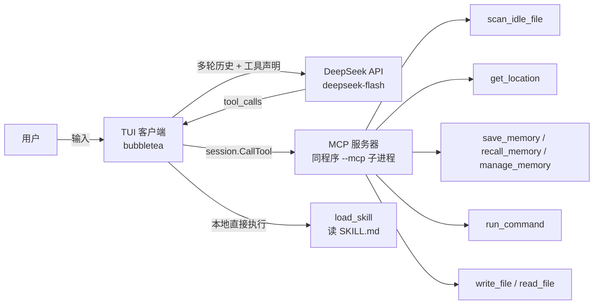
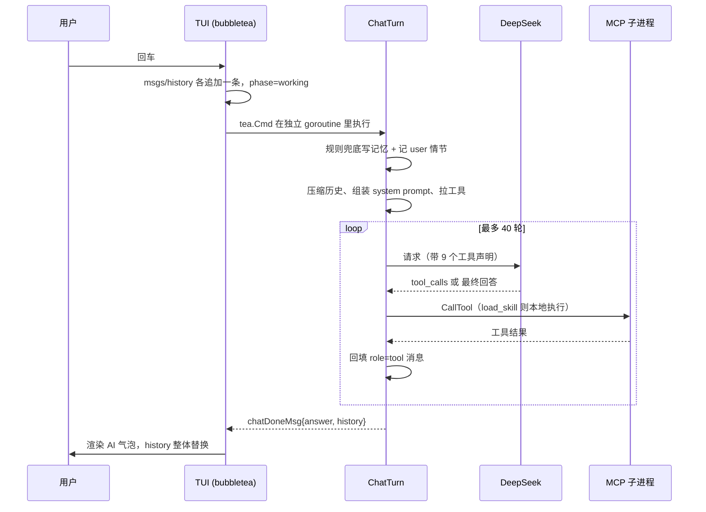
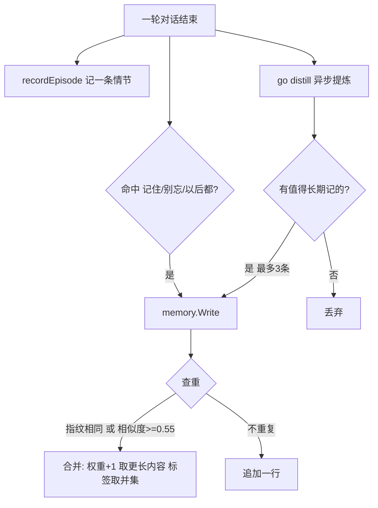

# wuhu

一个用 Go 手写的小型 Agent：**终端 TUI 聊天界面 + 自带 MCP 工具服务器 + 技能系统 + 长期记忆 + 上下文压缩**。

没有套任何 Agent 框架 —— 对话循环、工具注册、技能加载、记忆读写、上下文预算，全部自己写。整个程序只有一条 `main`，按参数决定自己是 "聊天客户端" 还是 "工具服务器"。

> 起点只是 "遍历文件夹，找出闲置文件"，后来一点点长成：能调本机命令、能读写文件、能按需加载技能、能记住你上次说过什么、聊久了也不会把上下文撑爆。

## 功能一览

| 能力 | 说明 |
| --- | --- |
| 终端聊天界面 | bubbletea + lipgloss，全屏 TUI、思考动画、鼠标滚轮翻历史 |
| 自造 MCP 工具 | 官方 `modelcontextprotocol/go-sdk`，工具以 stdio JSON-RPC 提供，客户端动态拉取 |
| 技能系统 | 扫描 `SKILL.md` 只注入 "名字 + 用途"，模型按需 `load_skill` 拉正文，正文不进常驻上下文 |
| 闲置文件扫描 | 按 atime 判定闲置，支持扩展名 / 最小体积过滤，自动跳过 `node_modules` 等目录，导出 Markdown 报表 |
| 本机命令执行 | cmd 或 PowerShell 两种模式，GBK 自动转 UTF-8，输出超限截断，旁路审计日志 |
| 文件读写 | 纯文本读写，写入自动建父目录；读取支持分页，长文件可分段读完 |
| 长期记忆 | 本地 JSONL 存储，判重合并、三槽注入、遗忘曲线淘汰，支持列出 / 修改 / 删除 |
| 情节记忆 | 记录 "上次到底聊了什么"，新会话开场自动接上上下文 |
| 上下文压缩 | 预算 60k token，到 80% 才压一次，压不动就硬裁，绝不 400 |
| 定位查询 | 基于公网 IP 的城市级位置，无系统权限依赖 |
| 配置容错 | 配置缺节点、JSON 写坏都不致命，一律回落代码内默认值 |

## 整体架构

单个可执行文件，两种身份：



启动流程：

1. `main` 检查 `os.Args[1] == "--mcp"`，是就把自己当 MCP 服务器跑起来（stdio 传输）；
2. 否则先 `llm.InitSkills(llm.DefaultSkillRoots())` 扫一遍技能目录，再作为 TUI 客户端启动；
3. 通过 `mcp.CommandTransport` 再拉起一份 `自己 --mcp` 子进程，建立 `ClientSession`；
4. TUI 每轮把整段历史交给模型，模型要调工具就由这个会话执行。

工具列表每次对话开始时拉一次，然后和本地的 `load_skill` 一起转成 OpenAI 的 `function` 声明交给模型。模型返回 `tool_calls` 时逐个执行：`load_skill` 在客户端就地读文件，其余全部走 `session.CallTool`，结果回填成 `tool` 消息继续循环。死循环有闸：**一次对话最多 40 轮工具往返**（模型每轮可以并行发多个 `tool_calls`，这一轮只记 1 次），超了强制让模型收尾作答。

## 内置工具（MCP）

| 工具名 | 主要参数 | 作用 |
| --- | --- | --- |
| `scan_idle_file` | `targetPath` `idleDays` `exportMdPath` `extensions` `excludeDirs` `minSizeMB` `maxResults` | 扫描超过阈值天数未访问的文件；回给模型的是数量、可释放空间合计、Top 5 大文件，明细导出 Markdown |
| `get_location` | 无 | 调 ip-api.com，返回城市级位置、经纬度、时区、运营商、公网 IP |
| `save_memory` | `content` `tags` | 写入长期记忆，重复内容自动并入旧条目 |
| `recall_memory` | `keyword` `limit` | 按相关度检索记忆，最多 10 条 |
| `manage_memory` | `action` `id` `content` `tags` `status` `keyword` `limit` | 记忆库管理：`list` 列出、`update` 修改、`delete` 删除，补上 `save_memory` 记错改不了的缺口 |
| `run_command` | `command` `workdir` `timeout` | 在本机执行 shell 命令，返回 stdout / stderr / 退出码，超时默认 30 秒，输出默认截断到 32KB |
| `write_file` | `path` `content` `append` | 写文本文件，自动创建目录；默认覆盖，`append=true` 追加 |
| `read_file` | `path` `offset` `maxBytes` | 读文本文件；分页读，默认 64KB、上限 512KB，截断时提示下一次的 `offset` |

还有一个 **本地工具** `load_skill`（不走 MCP）：

| 工具名 | 参数 | 作用 |
| --- | --- | --- |
| `load_skill` | `name` | 读取某个技能的 `SKILL.md` 正文，返回技能目录绝对路径，供模型拼 `references/` 等相对路径 |

工具注册用的是 SDK 的泛型写法：

```go
mcp.AddTool(server, &mcp.Tool{
    Name:        "scan_idle_file",
    Description: "扫描本机指定目录，找出超过阈值天数没有访问（atime）的闲置文件……",
}, runScanIdleFile)
```

入参结构体带 `jsonschema` 标签，**schema 自动生成**，参数反序列化、按 schema 校验、错误包装全交给 SDK。加新工具只需要在 `StartAutoServer` 里多挂一行 `registerXxx(server)`，不用维护注册表和映射。

错误语义也按 MCP 规范走：业务失败返回 `IsError=true` 的结果，让模型能看见 "失败了、失败在哪"，而不是当成正常输出继续编。

## 技能系统

技能就是一堆放在磁盘上的 `SKILL.md`。**核心是渐进披露**：常驻上下文里只有一行 "名字：什么时候用"，正文等模型点名了才读。

目录约定（只认一层，不递归）：

```text
<技能根>/
├── gsap-core/
│   ├── SKILL.md          # 必须有，且带 YAML frontmatter
│   └── references/       # 正文里引用的资料，按需再读
└── design-taste/
    └── SKILL.md
```

技能根的查找顺序（同名先到先得）：

| 优先级 | 来源 |
| --- | --- |
| 1 | 环境变量 `AGENT_SKILLS_ROOT`，多个用 `;` 分隔 |
| 2 | 当前工作目录下的 `skills/` |
| 3 | 可执行文件同目录的 `skills/` |

只读一层是刻意的：一个目录在不在清单里，看层级一眼就知道，不会因为某个仓库多套了两层目录，就把示例、变体一起塞进 prompt。

### frontmatter 只解析两个键

`SKILL.md` 头部长这样：

```yaml
---
name: gsap-core
description: >-
  用 GSAP 做网页动画时使用。覆盖 tween、timeline、ScrollTrigger 的基础用法……
---
```

解析器是手写的，不引 YAML 库，只认 `name` 和 `description`：

- 只读文件头部 **4KB**，不为两行元数据把几十 KB 正文读进来
- 支持折叠块写法（`>-` / `|` 后面缩进续写），`taste` 那种跨 10 行的描述能拼成一行
- 缩进行一律跳过，否则 `metadata.bins`、`hooks.command` 里的 shell 命令会被误读成技能名
- 兼容 CRLF、BOM，以及 "整个文件被包在代码块里" 的畸形写法

### 注入的清单长什么样

```text
【可用技能】以下是本机已安装技能，只给了名字和用途，正文尚未加载。
规则：任务与清单里某条用途吻合时，先调用 load_skill 读正文再执行；一个任务可能需要多个技能配合……
- gsap-core：用 GSAP 做网页动画时使用。覆盖 tween、timeline……
- design-taste：做落地页、海报这类需要审美判断的视觉任务时使用……
```

清单不限制技能数量，只表达 "按需加载"。实测 9 个真实技能、全量描述约 3500 字 ≈ 1000 token，占 60k 预算不到 2%；清单固定还能吃到前缀缓存。描述超过 2000 字才会被截断（保留头 3/4 + 尾 1/4，因为尾部通常是 "Use when …" 的触发语）。

### 加载时怎么防越界

`FindSkill` **只在扫描出来的索引里查**，绝不拿模型给的字符串拼路径 —— 传 `../../etc/passwd` 只会得到 "没有名为 xxx 的技能"，路径永远来自启动时的扫描结果。

单次正文上限 5 万字符，超了会提示 "用 read_file 从哪个 offset 继续读"，而不是把上下文一次打穿。

## 一轮对话是怎么跑的



界面层是 bubbletea 的单线程状态机：`phaseIdle` 时按键进输入框，`phaseWorking` 时按键只喂 spinner、输入框冻结。真正跑模型的 `ChatTurn` 被塞进 `tea.Cmd`，bubbletea 会把它丢到**独立 goroutine**，所以同步阻塞几十秒也不会让界面假死。

回填时有个细节：先记 `atBottom := m.viewport.AtBottom()`，你正在往上翻历史的话，新回复不会把你拽回底部。

## 长期记忆

事实记忆存在 `memory/memory.jsonl`，一行一条，append-only；情节记忆单独放 `memory/episodes.jsonl` —— 两者生命周期不同，混在一起会被淘汰逻辑误删。

一条记忆长这样：

```json
{"id": 3, "time": "2026-11-17 10:20", "updated": "2026-11-17 10:20", "kind": "preference",
 "content": "用户偏好回复用中文", "tags": "偏好,语言", "source": "distill",
 "weight": 3, "status": "active", "verified": "2026-11-17", "finger": "用户偏好回复用中文"}
```

`kind` 分 `fact / preference / task / project / rule / env`，`status` 分 `active / done / dropped`，`weight` 是 1~5 的优先级。

### 记忆是怎么进去的



- **旁路提炼**：每轮回答完，`go distill(...)` 在后台让模型只从 "本轮" 里挑值得长期保留的事实、偏好、决定，最多 3 条。异步、20 秒超时、失败静默 —— 记忆挂了不影响聊天。
- **规则兜底**：`autoRemember` 命中 "记住、记一下、别忘了、以后都……" 这类关键词就直接落一条，防模型偷懒不调 `save_memory`。
- **判重合并**：`memory.Write` 是唯一写入口。靠指纹（归一化后只剩实义字）精确命中，配合覆盖度 + Dice 的综合分 `0.6*Coverage + 0.4*Dice`，相似度 ≥ 0.55 就合并；归一化后不足 6 个字的短句退回纯 Dice，宁可不错并。合并时权重 +1（封顶 5）、内容取信息更全的那句、标签取并集。

### 记忆是怎么被用上的

每轮组装 system prompt 时**重新读一次记忆文件**，所以刚写进去的下一轮就能用。注入分三槽，总预算 600 字符：

| 槽位 | 内容 | 条数上限 |
| --- | --- | --- |
| 用户画像 | preference 优先，其次 fact | 3 |
| 未完成的待办 | `kind=task` 且 active | 4 |
| 相关经验 | 与当前这句话相关度 ≥ 0.10 的记忆 | 5 |

相关槽的打分是 `0.5*相关度 + 0.3*新鲜度 + 0.2*权重`；新鲜度按 30 天半衰期算，就是最小号的遗忘曲线。`recall_memory` 用的是同一套 `Rank`，保证 "工具查到的" 和 "提前塞进 prompt 的" 标准一致。

画像槽只放 3 条是刻意的：它每轮都在场，塞满 8 条的结果是任何一条偏好都会黏在每次对话里，把真正该说的那句稀释掉。

### 记错了能改

`save_memory` 只能新增或合并，改了主意就没辙。所以补了一个 `manage_memory`：

| action | 作用 |
| --- | --- |
| `list` | 按写入顺序列出全部记忆，可按关键词过滤，默认 20 条 |
| `update` | 按 `#编号` 改正文 / 标签 / 状态，正文一变会重算指纹和验证日期 |
| `delete` | 按 `#编号` 删除，回话里带上被删的原文，方便确认删对了 |

### 记忆维护

- 启动时、以及每 10 轮对话后，`go memory.Maintain(...)` 后台跑一次；
- 先 `Compact`：丢掉 `dropped` → 两两合并重复（同 kind 或指纹相同）→ 超过 200 条按 "权重为主 + 30 天内验证过加分" 淘汰，**preference 类型保命**；
- 再 `PruneEpisodes`：情节库只留最近 300 条；
- 整份重写走 "先写 `.tmp` 再 `rename`"，中途崩了原文件仍完整；进程内用 `sync.Mutex` 串行化写入。

### 情节记忆

情节只记 "发生了什么"，不记结论，每条截断 200 字。新会话第一句才注入最近 6 条，相邻两条间隔超过 **30 分钟**就插一行 `─── 新会话 ───` 分隔 —— 否则模型会把昨天的话题当成眼下的上下文。

## 上下文管理

模型是 `deepseek-flash`（理论上限 1M token），但**不贴着上限用**，成本是按 token 线性涨的：

| 参数 | 值 | 含义 |
| --- | --- | --- |
| 预算 | 60k token | 上限的 6% |
| 触发线 | 预算 80% | 留余量给压缩请求本身，真满了再压会 400 |
| 保留段 | 预算 40% | 最近这段原样保留 |
| 压缩目标 | 预算 30% | 压完还必须这么小，否则判定失败 |

流程：平时什么都不做 → 到 80% 调一次模型把老对话压成摘要（保留事实、决定、工具结论，删寒暄和失败重试）→ 压完仍超 30% 就**降级硬裁**，直接丢最老的。

三个细节：

- 切点必须对齐到 `user` 消息，从中间硬切会切出 "孤儿 tool 结果" 导致 400；
- token 数不做真分词，中文按字、英文按 4 字符粗估，够判阈值就行；
- `system` 消息每轮都是新建的，不会留在历史里越滚越长；旧摘要按原样挂在历史头部，下一轮继续接上。

### 上下文不是记忆

这两个经常被混成一句 "满了清掉就行"，其实不是一个东西：

| | 上下文 | 长期记忆 |
| --- | --- | --- |
| 载体 | `m.history`（内存切片） | `memory/memory.jsonl` |
| 生命周期 | 进程结束就没了 | 跨进程、跨会话 |
| 满了会怎样 | 到 80% 预算自动压缩、压不动硬裁 | 超过 200 条自动淘汰 |
| 怎么清 | **退出程序重开** | 备份后删文件（删了就是永久失忆） |

清空 `memory.jsonl` 不会让上下文变小一圈 —— 它只影响每轮注入的那 600 字。

## 快速开始

```bash
git clone https://github.com/gaoz30500-beep/wuhu.git
cd wuhu
go mod tidy
go run .
```

打包成单文件：

```bash
go build -o wuhu.exe .
./wuhu.exe        # TUI 客户端
./wuhu.exe --mcp  # 作为 MCP 服务器（正常情况下由客户端自动拉起，不用手动跑）
```

启动后直接说话，例如：

- `扫描 E 盘的闲置文件`
- `看看 E 盘下哪些文件超过 30 天没打开过，只看超过 100MB 的`
- `记一下：我习惯用 VS Code 写代码`
- `我以前说过我电脑是什么配置？`
- `把记忆库里关于显示器的条目列出来`
- `帮我看看当前目录下有什么`

界面键位：回车发送，`PgUp/PgDn` `↑/↓` `Ctrl+U/Ctrl+D` 翻历史，鼠标滚轮也能滚，`Ctrl+C` 或 `Esc` 退出。

### 装技能

把技能放成 `skills/<技能名>/SKILL.md`，启动就会自动扫到。放在项目外面也行：

```powershell
$env:AGENT_SKILLS_ROOT="D:\my-skills"
```

### API Key

程序里用的是 DeepSeek 的 OpenAI 兼容接口（`https://api.deepseek.com`）。运行前把 Key 填进去，建议改成读环境变量，**不要把 Key 硬编码进代码再推到公开仓库** —— 一旦进了 git 历史，删文件也没用，只能去后台吊销重发。

## 配置

配置文件默认找 `MCP/mcp_config.json`，查找顺序：环境变量 `AGENT_MCP_CONFIG` → 当前工作目录下 `MCP/mcp_config.json` → 可执行文件同目录的 `mcp_config.json`。

```json
{
  "tools": {
    "scan_idle_file": {
      "targetPath": "E:",
      "idleDays": 30,
      "exportMdPath": "./out/result.md",
      "excludeDirs": ["node_modules", ".git", "venv"],
      "extensions": ["log", "tmp", "zip"],
      "minSizeMB": 50,
      "maxResults": 5000
    },
    "get_location": {
      "apiUrl": "http://ip-api.com/json/?lang=zh-CN",
      "timeout": 8
    },
    "save_memory": { "storePath": "memory/memory.jsonl" },
    "recall_memory": { "storePath": "memory/memory.jsonl" },
    "run_command": {
      "workdir": ".",
      "timeout": 30,
      "logpath": "./out/command.log",
      "shell": "cmd",
      "maxOutputKB": 32
    }
  }
}
```

原则是**任何节点、任何字段都可以缺省**：缺了就回落代码里的默认值。以前缺一个 `tools` 节点整个 server 都起不来，等于一个工具的配置写错就拖垮全部工具 —— 现在 JSON 写坏也只是打一条 stderr 日志，照常用默认值跑。

其他环境变量：

| 变量 | 作用 |
| --- | --- |
| `AGENT_MCP_CONFIG` | 指定配置文件路径 |
| `AGENT_MEMORY_PATH` | 覆盖事实记忆库路径 |
| `AGENT_EPISODE_PATH` | 覆盖情节记忆库路径 |
| `AGENT_SKILLS_ROOT` | 技能根目录，多个用 `;` 分隔 |

> MCP 服务器跑在 stdio 上，**stdout 是 JSON-RPC 通道**，所有日志只能写 stderr。往 stdout 打一行字，协议流就乱了。

## 目录结构

```text
.
├── main.go              # 入口 + TUI 界面（bubbletea 模型、渲染、键位）
├── LLM/
│   ├── ChatLoop.go       # 对话循环：拉工具、本地分流 load_skill、执行 tool_calls、40 轮上限
│   ├── ContextWindow.go  # token 估算、懒压缩、硬裁
│   ├── MemoryDistill.go  # 旁路提炼（异步 distill）
│   ├── SystemPrompt.go   # system prompt 组装、三槽注入、规则兜底、情节记录、技能清单
│   ├── SkillToolDef.go   # load_skill 的工具声明与技能元数据
│   ├── SkillToolRun.go   # 技能扫描、frontmatter 解析、索引、正文加载
│   └── MCPToolBridge.go  # MCP 工具声明 → OpenAI function 声明
├── MCP/
│   ├── MCPServer.go      # server 组装，挂载全部工具
│   ├── RunMCPServer.go   # --mcp 分支入口
│   ├── config.go         # 配置加载与查找顺序
│   ├── ToolScan.go       # scan_idle_file（过滤、汇总、Top 5、导出）
│   ├── ToolLocation.go   # get_location
│   ├── ToolMemory.go     # save_memory / recall_memory
│   ├── ToolMemoryAdmin.go# manage_memory（list / update / delete）
│   ├── ToolCommand.go    # run_command（编码、引号改写、截断、日志）
│   ├── ToolWrite_File.go # write_file / read_file（分页）
│   ├── mcp_config.json   # 工具默认值
│   └── learn/            # MCP 分步学习示例（协议、角色、stdio 等）
├── memory/
│   ├── store.go          # Record 定义、LoadAll、Search、Render
│   ├── write.go          # 唯一写入口：查重 → 合并 / 追加
│   ├── finger.go         # 归一化、指纹、Dice、覆盖度、判重综合分
│   ├── rank.go           # 打分、三槽渲染、预算内截断
│   ├── maintain.go       # Update / Delete / Compact / Maintain
│   ├── admin.go          # List：按关键词列出记忆
│   └── episode.go        # 情节记忆的写入、渲染、裁剪
├── scanner/
│   ├── Scanner.go        # WalkDir 遍历 + 排除目录 / 扩展名 / 体积 / 条数过滤
│   ├── Resolver.go       # IdleResolver 策略接口（可换 mtime 等实现）
│   ├── ValidateDirPath.go# 路径校验（不存在 vs 没有闲置文件要分开报）
│   └── Resource.go       # 扫描结果结构
└── OutPut/
    ├── Output_Define.go  # Markdown 报表模板导出
    └── Dto.go            # ReportItem
```

## 技术栈

| 用途 | 依赖 |
| --- | --- |
| 模型接入 | `github.com/sashabaranov/go-openai`（指向 DeepSeek 兼容接口） |
| 工具协议 | `github.com/modelcontextprotocol/go-sdk`（stdio JSON-RPC） |
| TUI | `charmbracelet/bubbletea` + `bubbles` + `lipgloss` |
| 控制台编码 | `golang.org/x/text/encoding/simplifiedchinese`（GB18030 转 UTF-8） |
| 语言 | Go 1.26 |

不引入 tokenizer、向量库、数据库、ORM、YAML 库：记忆是纯文本 JSONL，检索是二元组 + Dice，上下文判阈值靠粗估，技能元数据手写解析。够用，而且打开文件就能看懂里面是什么。

## 设计取舍

- **自己造 MCP server 而不是接第三方的**：单文件、零外部依赖、随 exe 一起走；工具和 Agent 同仓，改工具不用对齐两套代码。
- **技能只注入元数据，不注入正文**：正文动辄几十 KB，一个任务用到三个技能就能把 60k 预算吃掉一半。只给 "名字 + 用途"，让模型自己决定加载谁，是最省 token 的分法。
- **`load_skill` 走本地、不走 MCP**：它只读本机文件，没有外部副作用，绕一趟子进程纯属浪费；顺便也给了个示例 —— 不是所有工具都必须挂在 MCP 上。
- **工具失败要能被模型看见**：一律走 `IsError=true`，模型读到错误原文才知道该改参数重试，而不是把错误当结论继续往下编。
- **判重不靠 "整句子串匹配"**：那套永远命不中，等于没查重。换成归一化指纹 + 覆盖度，才能认出 "换种说法"。
- **记忆宁缺毋滥**：注入分三槽、条数有上限、预算 600 字、相关度有门槛。宁可少放，也不堆一堆把 prompt 稀释掉。
- **命令输出必须截断、编码必须翻译**：`dir /s` 能吐几 MB，GBK 中文直接 `string(out)` 全是乱码；这两个不处理，工具结果本身就会把上下文打穿或让模型读不懂。
- **一切维护都异步且静默**：压缩、提炼、维护、命令日志，失败都不许影响当前这轮回答。

## 已知限制

- **主对话请求没有超时**。`ChatTurn` 的 `ctx` 是 `context.Background()`，`CreateChatCompletion` 和压缩请求都没设 deadline。DeepSeek 挂住或网络半断时，这一轮会永久停在 `phaseWorking`，只能 `Ctrl+C`。
- `maxTurns` 数的是 "轮" 不是 "工具次数"。模型一次返回 5 个 `tool_calls`，这一轮只加 1，但 5 个工具全执行。提示文案写的 "工具调用上限 40 次" 与实际计数口径不完全一致。
- `run_command` 的 "改动类命令先向用户确认" 目前是**提示词约束**，没有代码级的二次确认拦截；真要动重要文件，还是先看清模型打算执行什么。
- 闲置判定依赖 Windows 的 `Win32FileAttributeData.LastAccessTime`，且系统盘常开着 "禁用最后访问时间" 策略，atime 可能不准；跨平台需要另写 `IdleResolver` 实现。
- 记忆检索是词面匹配，理解不了真正的同义改写；没有向量召回。
- 扫描是同步遍历，盘特别大时会让人等；没有进度条，只有 spinner。
- 技能索引只在启动时扫一次，改完 `SKILL.md` 要重启才生效（`ReloadSkills` 函数已经写了，只是没接到 TUI 上）。

## Roadmap

- [ ] API Key 改走环境变量 / 本地配置文件，不留在源码里
- [ ] 主对话请求加 deadline，避免无限挂起
- [ ] 改动类命令的代码级确认闸（危险命令白名单 / 黑名单）
- [ ] 技能热加载（接到 `ReloadSkills`，目录变化自动重扫）
- [ ] 扫描进度回调，TUI 里显示实时计数
- [ ] 记忆检索加向量召回，替换纯词面匹配
- [ ] 跨平台 `IdleResolver`（mtime / 自定义规则）
- [ ] 更多工具：压缩解压、进程查看、网络请求
